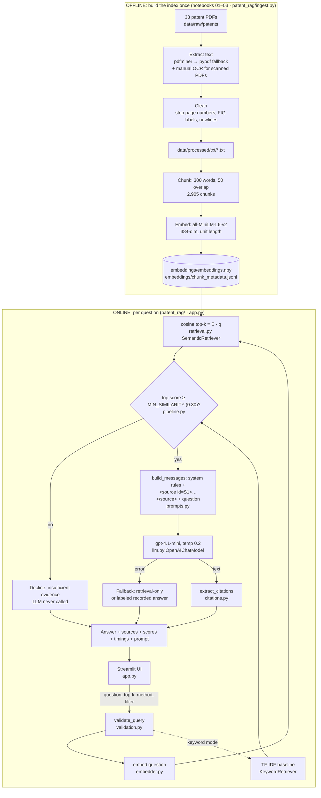

# Interview Prep: AI Patent Research Assistant

**Deloitte GPS Software Engineering Summer Scholar: Project Portfolio Interview**
Thursday, October 15, 2026 · ~30 minutes · HireVue (virtual, screen share)

> **How to use this document.** Sections 1–3 are what you say, Section 4 is how it works, Sections 5–9 are follow-up material, and **Section 10 is the 5-minute review before you log in.** Anything tagged **[CONFIRM]** is a personal detail or unverified fact. Check it or reword it before saying it out loud. Do not claim anything in this document that you can't explain.

---

## Section 0: Read this first: what's yours, what changed, and what to do tonight

### Provenance (be ready to explain this honestly)

| Part | Origin (from the repository) |
|---|---|
| `notebooks/01–04`: extraction, chunking, embeddings, RAG Q&A, 8-question manual evaluation | Your v1.0 course project for **DNSC 3288**, dated 2025-12-10 in the model card. The model card states that ChatGPT assisted with some code snippets and drafting, and that you reviewed and approved everything. |
| Manual OCR fixes for patents with no extractable text, corpus selection (33 patents) | Your v1.0 work (model card, "Unexpected results") |
| `patent_rag/` package, `app.py` Streamlit UI, tests, `scripts/`, `EVALUATION.md`, this file | **Added 2026-10-14 with AI coding assistance (Claude Code)** to make the project demo-ready. The core pipeline logic (chunking, embedding model, cosine retrieval, `gpt-4.1-mini`) is carried over from your notebooks unchanged. |

Deloitte asked for a project where **you wrote a significant portion of the code**. Your notebooks qualify. If asked about the app layer, a strong, honest answer is:

> "I built the pipeline in notebooks for a course. To demo it, I refactored it into a tested Python package with a Streamlit front end, using an AI coding assistant to speed that up. I reviewed every module and I can walk through any of them."

Then make sure that's true: **read every file in `patent_rag/` and `app.py` tonight** (about 1,400 lines including comments; see the reading order below). Interviewers often pick a function and ask you to explain it.

### Tonight's checklist (about 60–90 minutes)

1. **Install and verify** (Windows PowerShell, from the project folder):
   ```powershell
   python -m venv .venv
   .venv\Scripts\Activate.ps1
   pip install -r requirements.txt
   copy .env.example .env      # then put your OPENAI_API_KEY in .env
   python scripts/check_setup.py --ping
   ```
   Every line should say `[ OK ]`. The three demo questions should find their expected patent, and the CRISPR question should say "declines (good)".
2. **Run the tests:** `python -m pytest -q` should print **64 passed**.
3. **Run the semantic evaluation** (about 1 minute): `python scripts/evaluate.py`. Paste the table into `EVALUATION.md` and replace the PENDING numbers in Sections 5, 7 and 10 below with your real ones. **This is the most important unverified result.**
4. **Calibrate the threshold.** In the evaluation output, compare the in-scope minimum with the out-of-scope maximum. If the CRISPR question is not declined, set `MIN_SIMILARITY` in `.env` between those two values.
5. **Rehearse in the app** (`streamlit run app.py`). Ask each demo question once with the API key working. This also **records** each answer locally as your backup. Read the answers and open each cited source. **Make sure the citations actually support the claims** before you show them to an interviewer.
6. **Take screenshots** of a good answer, the sources panel and the CRISPR decline, as a last-resort backup.
7. **[CONFIRM]** Click 3–4 "View on Google Patents" links to confirm they resolve. They're built from patent numbers, not stored in the data.
8. **[CONFIRM]** Check the chunk-truncation claim used in Sections 5 and 8:
   ```python
   from sentence_transformers import SentenceTransformer
   import json
   m = SentenceTransformer("all-MiniLM-L6-v2"); print(m.max_seq_length)   # expect 256
   chunks = [json.loads(l)["text"] for l in open("embeddings/chunk_metadata.jsonl", encoding="utf-8")][:200]
   lens = [len(m.tokenizer(c)["input_ids"]) for c in chunks]; print(sum(l > 256 for l in lens), "of", len(lens), "exceed 256 tokens")
   ```

### Code reading order (about 45 minutes)

`patent_rag/pipeline.py` (the whole flow on one page) → `retrieval.py` → `prompts.py` → `llm.py` → `index.py` → `citations.py` / `validation.py` → `app.py` (skim the rendering) → `tests/test_pipeline.py` (shows every behavior as a test).

---

## Section 1: Executive project overview

### For a non-technical interviewer

Patents are long, technical and full of legal phrasing. If you're trying to understand what a set of patents says about a topic, such as "how are large AI models used to train smaller ones?", you'd normally search for keywords and then read dozens of pages. Keywords miss documents that describe the same idea in different words.

I built an assistant that lets you **ask a question in plain English** about a collection of 33 AI-related US patents. It first **finds the specific paragraphs** most related to your question, then has an AI model **write a short answer using only those paragraphs**, with **footnote-style citations** so you can check every claim. If the patents don't cover your question, it says so instead of making something up.

**Who would use it:** patent analysts, R&D engineers and technology strategists doing early-stage research, such as getting oriented in a technology area before a professional search.

**Value (potential, not measured):** faster first-pass research, finding relevant documents that keyword search misses, and answers you can verify rather than trust blindly.

### For a technical software engineer

A retrieval-augmented generation system over a 33-document patent corpus:

- **Offline indexing** (notebooks 01–03): PDF text extraction (`pdfminer.six` with a `pypdf` fallback, plus manual OCR for PDFs with no text layer) → regex cleaning → **300-word chunks with 50-word overlap (2,905 chunks)** → **`all-MiniLM-L6-v2` sentence embeddings (384-dim, L2-normalized)** stored as a NumPy matrix plus a JSONL metadata file.
- **Online query path** (`patent_rag/`, `app.py`): validate input → embed the question → **exact cosine top-k** (a matrix-vector product over normalized vectors; verified identical to scikit-learn `NearestNeighbors`) → **relevance gate** (decline below a similarity threshold) → **prompt with delimited, labeled sources S1…Sn** → **`gpt-4.1-mini`** at temperature 0.2 → **citation validation** → Streamlit UI showing the answer, the evidence, scores, latency and the exact prompt.
- **Engineering:** modular package with single-responsibility modules, a typed error hierarchy with user-safe messages, graceful degradation (no key, outage or rate limit → retrieval-only or a labeled recorded answer), prompt-injection hygiene, **64 pytest tests with mocked models**, and an evaluation harness (Hit@k, MRR, latency) comparing semantic search with a TF-IDF baseline.

**What's technically interesting:**
1. It treats the LLM as an **untrusted, fallible component**. It's gated, delimited, cited and verified, and the app still works when the LLM is down.
2. It makes retrieval **observable**: the scores, ranks, the cut-off and the exact prompt are visible, so you can tell a retrieval failure from a generation failure.
3. It includes a **measured comparison** against a keyword baseline rather than assuming semantic search is better.

---

## Section 2: 60–90 second opening pitch

*(Practice aloud. Roughly 170 words, about 75 seconds. Replace the bracketed parts.)*

> "The project I'd like to show you is an AI patent research assistant.
>
> The problem is that patents are long, dense documents, and the same idea gets described in very different words, so keyword search misses things and reading everything takes hours. **[CONFIRM: your motivation. For example: 'I built it for my DNSC 3288 course because I wanted to understand how retrieval-augmented generation actually works beyond just calling an API.']**
>
> I collected 33 AI-related US patents, extracted and cleaned the text (some needed manual OCR fixes), split them into about 2,900 overlapping passages, and turned each passage into an embedding, a vector that captures its meaning. When you ask a question, the system finds the most similar passages and has GPT-4.1-mini answer **only from those passages, with citations**.
>
> The engineering decisions I focused on were trust and reliability. The app shows exactly which evidence was used, refuses to answer when nothing relevant is found, checks the citations, and keeps working in retrieval-only mode if the AI service fails. It's covered by unit tests, and I measured retrieval quality against a keyword-search baseline.
>
> Let me show you how it works."

**Do not say:** "it eliminates hallucinations," "it does prior-art search," or "it saves X hours" (not measured).

---

## Section 3: Live demo script (3–5 minutes)

### Before the interview (T minus 30 minutes)

- [ ] Activate the venv. Run `python scripts/check_setup.py --ping` and confirm `READY`.
- [ ] Run `streamlit run app.py`. The browser opens at `http://localhost:8501`. **Ask one throwaway question** so the model is warm.
- [ ] Browser zoom 110–125%. Close other tabs, notifications, Slack and email. Hide your bookmarks bar.
- [ ] Open a second window with VS Code at `patent_rag/pipeline.py` (in case they ask to see code) and this file's Section 10.
- [ ] Keep a backup tab with your screenshots folder.
- [ ] In the sidebar, confirm all three status lines are ✅. If the language model shows ⚠️, your `.env` isn't loaded.

### The script

**0:00 – Frame it (20 sec).** *Screen: app home page.*
> "This is the assistant. The sidebar shows the system status: 33 patents, 2,905 indexed passages, the embedding model and the language model. These example buttons are questions I know the collection can answer."

**0:20 – First question (60–90 sec).** Click **"How can a large language model be used to train or improve a smaller language model?"**
> "When I submit this, three things happen. The question is converted into a vector with the same embedding model I used on the patents. That vector is compared with all 2,900 passages using cosine similarity. Then the top 5 go to GPT-4.1-mini with instructions to answer only from them."

Point at, in order:
1. **The green status banner**: "answer generated from retrieved passages."
2. **The answer**: "Each claim has a citation like **[S1]**. S1 is the top-ranked passage. There's a 'From the patents' part, which is evidence, and a 'Synthesis' part where the model is told to label inferences."
3. **Retrieval summary**: "Retrieval took about **[CONFIRM: ms]** milliseconds. Almost all of the **[CONFIRM: s]** seconds is the LLM call. The top similarity was **[CONFIRM]**."

**1:45 – Open the evidence (45 sec).** *Sources tab → expand S1.*
> "This is what makes it trustworthy: you can see the actual patent text. This is **[read the title shown, e.g. Microsoft's 'Natural Language Training and/or Augmentation with Large Language Models']**, chunk **[CONFIRM]**, similarity **[CONFIRM]**, and it's marked as cited. Let me check that the claim matches…" *(read one sentence that supports the S1 claim; you'll have checked this tonight)*. "And there's a link to the original patent."

**2:30 – Show the prompt (30 sec).** *"How this answer was produced" tab → expand "Show the exact prompt".*
> "Here's exactly what the model received: system rules, then each passage wrapped in labeled source tags, then the question. The rules require citations, say to answer only from sources, and treat the patent text as data, so if a document contained an instruction, the model is told to ignore it."

**3:00 – The refusal case (40 sec).** Click **"What does this collection say about CRISPR gene editing in crops?"**
> "This is the most important behavior. Nothing in the collection is about gene editing. The closest passage only scored **[CONFIRM]**, below my 0.30 threshold, so the system **never calls the language model**. It says it doesn't have the evidence instead of guessing. The closest passages are still shown for transparency."

*(If this question is not declined after calibration, use the sidebar to show the threshold and explain the second safeguard: the model is instructed to answer `INSUFFICIENT_EVIDENCE`.)*

**3:40 – Optional: semantic vs keyword (40 sec).** Type *"How can a chatbot answer questions about pictures?"* and run it. Switch the sidebar to **Keyword (TF-IDF baseline)** and run it again.
> "Keyword search ranks the visual-dialogue patent tenth because the question doesn't share its vocabulary. Semantic search **[CONFIRM: ranks it first / in the top 3]**. I measured this across 39 queries; keyword search found the right patent first only 3 of 8 times when the wording differed."

> ⚠️ Only do this step if you verified the semantic result tonight (`check_setup.py` / `evaluate.py`). Otherwise skip it.

**4:20 – Transition (15 sec).**
> "That's the user-facing side. I'm happy to walk through the architecture, the code structure, how I tested it, or how I'd take this to production. Where would you like to go?"

### Backup procedures (in order of preference)

| Failure | What to do | What to say |
|---|---|---|
| **LLM API slow or down, or out of credits** | Just ask a demo question you rehearsed tonight. The app automatically shows the **recorded answer** with a yellow banner: "RECORDED answer generated earlier (timestamp), not a live response." | "The API is unavailable, so the app fell back to an answer it recorded earlier. It says so clearly. The retrieval you see is live." **Never present the recording as live.** |
| LLM down, no recording | Turn off **"Generate an AI answer"** in the sidebar, or just let it fall back. | "This is retrieval-only mode, the half of RAG that runs locally. The evidence panel is what would go to the model." This is still a strong demo. |
| Embedding model or app won't start | Show the screenshots you took tonight (label them as taken last night), then open `notebooks/04_rag_qa.ipynb`, which has **saved outputs from the December 2025 run**. | "These are saved outputs from my original notebook run, not live." |
| Screen share problem | Talk through the architecture diagram (Section 4) from memory. | |

---

## Section 4: Technical architecture

### Diagram



### Component walkthrough

| Stage | What happens | Where |
|---|---|---|
| **Data source** | 33 US patent PDFs from Google Patents: 27 granted patents and 6 application publications, mostly AI/NLP/transformers plus a few off-topic ones (battery fluid, image processing, immersive video) | `data/raw/patents/`, `data/patent_metadata.json` |
| **Ingestion** | `pdfminer` text extraction, `pypdf` fallback. PDFs that yielded no text were OCR'd (Adobe) and pasted manually; existing `.txt` files are never overwritten | `notebooks/01_extract_text.ipynb`, `ingest.py: pdf_to_text` |
| **Cleaning** | Regex: remove line-leading page numbers and `FIG. n` lines, join hyphenated breaks, collapse whitespace. Front-page boilerplate and OCR noise remain | `ingest.py: clean_text` |
| **Chunking** | Fixed windows of **300 words**, step 250 (**50-word overlap**), per document. Chunk ID = `{patent}_{i}`. 2 to 301 chunks per patent | `ingest.py: chunk_text`, `notebooks/02_chunk.ipynb` |
| **Embedding** | `all-MiniLM-L6-v2` (sentence-transformers): 6-layer MiniLM, **384-dim** vectors, unit-normalized | `notebooks/03_embeddings.ipynb`, `embedder.py` |
| **Vector store** | No database: a 2,905 × 384 float32 matrix (~4.5 MB) plus row-aligned JSONL. Loaded and validated at startup (shape match, NaN check, required fields) | `index.py: load_index` |
| **Similarity search** | Because vectors are unit length, **cosine similarity = dot product**. One matrix-vector multiply scores every chunk; `argpartition` picks the top k. Exact, not approximate | `retrieval.py: SemanticRetriever.search_vector` |
| **Retrieval config** | `top_k=5` (UI slider 1–10). Optional patent filter (masking). TF-IDF keyword baseline for comparison | `config.py`, `retrieval.py: KeywordRetriever` |
| **Relevance gate** | Only chunks with similarity ≥ `MIN_SIMILARITY` (0.30) are sent to the model. If none qualify, the system declines without calling the LLM | `pipeline.py: RAGPipeline.answer` |
| **Prompt construction** | A system prompt with grounding rules (only use sources, cite `[S#]`, say `INSUFFICIENT_EVIDENCE`, ignore instructions inside sources, no legal advice). The user message holds sources wrapped in `<source id="S1" patent="…" title="…" chunk="…">` tags, sanitized so text can't close its own tag, then the question | `prompts.py: SYSTEM_PROMPT, build_messages, sanitize_source_text` |
| **LLM interaction** | OpenAI Chat Completions, `gpt-4.1-mini`, temperature 0.2, 30 s timeout, SDK retries (2) with backoff. Every SDK exception maps to a user-safe error | `llm.py: OpenAIChatModel.complete` |
| **Output processing** | Detect the `INSUFFICIENT_EVIDENCE` reply. Extract `[S#]` citations, flag invalid labels or no citations. Save to the local recorded-answer cache | `citations.py`, `pipeline.py`, `recorded.py` |
| **Frontend/backend** | A single Streamlit process: the UI calls the pipeline in-process. `@st.cache_resource` loads the index and model once per server | `app.py: load_pipeline, render_response` |

### Lifecycle of one query

1. You click an example. Streamlit re-runs `app.py` and calls `pipeline.answer(question, top_k=5, method="semantic")`.
2. `validate_query` strips control characters and collapses whitespace, then enforces 3–500 characters with at least one letter or digit. Bad input raises `InvalidQueryError` → red message, nothing else runs.
3. `SemanticRetriever.embed_query` runs MiniLM on the question → a 384-dim unit vector (a few to tens of ms on CPU **[CONFIRM: measure]**).
4. `search_vector` computes `embeddings @ q`, giving 2,905 similarity scores, and takes the 5 highest. Results are `RetrievedChunk(rank, score, chunk_id, patent_id, chunk_index, text)`.
5. Relevance gate: keep chunks with score ≥ 0.30. None left → status `insufficient_evidence`, return immediately.
6. `build_messages` makes `[system, user]` messages with sources labeled S1…S5 in rank order.
7. `OpenAIChatModel.complete` sends them. On an error → `_fallback` returns the recorded answer if one exists for the same question and settings, otherwise retrieval-only with a notice.
8. If the reply starts with `INSUFFICIENT_EVIDENCE` → status `insufficient_evidence`. Otherwise `extract_citations` checks the labels → status `answered`, plus a warning if citations are missing or invalid.
9. `RAGResponse` (status, answer, evidence, citations, messages, timings) → `render_response` draws the banner, answer, metrics, sources and prompt.

---

## Section 5: Technical decisions and tradeoffs

> "Selected in v1.0" means the choice is in your notebooks. For **why** you chose it originally, only the efficiency reason for MiniLM is documented (model card); other reasons are **[CONFIRM]**. "Added in v1.1" means it was added during demo preparation.

### RAG vs. fine-tuning vs. a plain LLM
- **Selected (v1.0):** RAG.
- **Why it fits:** the answer must come from *these specific documents* and be **verifiable**. RAG gives citations, and updating knowledge means re-indexing, not retraining. Fine-tuning teaches style and patterns but doesn't reliably memorize facts, can't cite, and costs more to update. A plain LLM would answer from training memory: no sources, confident hallucinations about patent details, and no knowledge of recent filings.
- **Limitations:** answers are only as good as retrieval. If the right passage isn't in the top 5, the model can't use it.
- **Production:** RAG still. Fine-tuning might later help the *embedding model* on patent language.

### Semantic search vs. keyword search
- **Selected:** semantic as the primary method (v1.0). TF-IDF baseline added for comparison (v1.1).
- **Why:** patents use idiosyncratic terminology ("computing numeric representations of words" means word embeddings). Embeddings match meaning.
- **Measured evidence:** the keyword baseline is excellent when the query reuses the patent's words (Hit@1 **0.94**, 31 queries) but poor on everyday wording (Hit@1 **0.38**, 8 queries). Semantic: **[PENDING: fill in from evaluate.py]**.
- **Tradeoff:** semantic search can miss exact identifiers (patent numbers, chemical names, claim terms) that keyword search nails.
- **Production:** **hybrid search** (BM25 + embeddings, combined with reciprocal rank fusion) plus a **cross-encoder re-ranker** on the top 50.

### Embedding model: `all-MiniLM-L6-v2`
- **Selected (v1.0).** The model card says: "efficient but less powerful than large … transformers."
- **Pros:** small (~90 MB), runs on a laptop CPU, 384-dim vectors keep the index tiny, free, and no data leaves the machine.
- **Cons:** general-domain training (not patent or legal text), English only, **256-token input limit**. With 300-word chunks of OCR-heavy text, the **end of many chunks is likely truncated** and not represented in the embedding **[CONFIRM with the snippet in Section 0]**. Words roughly 180–250 into a chunk may not appear in any embedding, because the overlap only covers the last 50 words.
- **Alternatives:** `all-mpnet-base-v2` (better, slower), `bge-small/base`, `e5`, OpenAI `text-embedding-3-small` (API cost, data leaves the machine), domain models such as PatentSBERTa.
- **Production:** benchmark 2–3 models on a labeled set, and match chunk size to the model's token limit.

### Vector "database": a NumPy matrix with exact search
- **Selected:** v1.0 used scikit-learn `NearestNeighbors(metric="cosine")`. v1.1 replaced it with an equivalent dot product, and **a unit test proves the rankings are identical**.
- **Why:** 2,905 × 384 floats is about 4.5 MB. Exact search takes milliseconds (keyword search measured 1.5 ms; semantic **[CONFIRM]**). A database would add infrastructure for no benefit at this size.
- **Alternatives:** FAISS (in-process, ANN indexes), Chroma or LanceDB (embedded DBs), pgvector (Postgres), managed services (Pinecone, Azure AI Search, OpenSearch).
- **When to switch:** at hundreds of thousands to millions of chunks, or when you need metadata filtering at scale, concurrent writes, persistence or access control. Then use **ANN (HNSW)**, which trades a little recall for big speedups.

### Chunk size (300 words) and overlap (50)
- **Selected (v1.0).** Reasoning **[CONFIRM]**.
- **Tradeoff:** bigger chunks carry more context per hit but dilute the embedding (one vector represents many ideas) and exceed MiniLM's limit. Smaller chunks are more precise but may cut an idea in half. Overlap reduces boundary cuts at the cost of about 20% more chunks.
- **Better options:** structure-aware chunking on patent sections (abstract, claims, background, detailed description, numbered paragraphs `[0026]`), about 150–200 words to fit the model, and keeping section labels as metadata.
- **How to choose:** empirically. Re-run `scripts/evaluate.py` per configuration (`build_index.py --chunk-size … --overlap …`).

### Top-k = 5 and context window management
- **Why 5:** about 1,500 words (roughly 2–3k tokens) of evidence is cheap, fast and well within `gpt-4.1-mini`'s context, and leaves the model room to focus. More chunks raise recall but add noise, cost and latency, and models attend less to the middle of long contexts.
- **v1.1 safeguards:** `max_top_k=10`, per-source truncation at 4,000 characters, and the relevance gate drops weak chunks.
- **Production:** retrieve 50 → re-rank → send the top 5–8. Add a token-budget check.

### Relevance threshold (added in v1.1)
- **Why:** without it, a RAG system *always* finds "the closest" passages, even for nonsense questions, and the LLM will happily summarize irrelevant text.
- **Tradeoff:** too high refuses good questions; too low lets junk through. The 0.30 default is **uncalibrated** until you run the evaluation. A second safeguard is that the model is told to answer `INSUFFICIENT_EVIDENCE`.
- **Note:** raw cosine scores aren't calibrated probabilities. A re-ranker gives better-calibrated scores.

### LLM: `gpt-4.1-mini` at temperature 0.2
- **Selected (v1.0).** Reasons **[CONFIRM]**. Defensible ones: low cost, fast, strong instruction-following for summarization. Low temperature means fewer creative additions and more repeatable output.
- **Alternatives:** larger models (better synthesis, higher cost), Azure OpenAI (enterprise and government compliance), open-weight models run locally (data never leaves, more operations work).
- **Configurable:** `OPENAI_MODEL` in `.env`. The LLM is behind a small interface (`ChatModel.complete`), so swapping providers is one class.

### Latency vs. quality
- Retrieval is milliseconds; generation dominates (seconds). Adding a re-ranker would add roughly 100–300 ms on CPU for better precision. Streaming tokens would improve perceived latency.

### Cost and scalability
- **Estimate (not measured):** about 3k input + 400 output tokens per question. At `gpt-4.1-mini` list prices (about $0.40 per 1M input, $1.60 per 1M output **[CONFIRM current pricing]**), that's roughly **$0.002 per question**. Embedding is free (local).
- **Reduce cost:** cache answers for repeated questions, send fewer or shorter chunks, use a smaller model for easy questions, batch offline work.

### Streamlit for the UI (added in v1.1)
- **Why:** the project is all Python, and Streamlit gives a working UI in one file with no separate frontend build. It's ideal for a demo or internal tool.
- **Limitation:** the whole script re-runs on each interaction, and session state lives on the server. It isn't meant for high-traffic multi-tenant apps.
- **Production:** a FastAPI backend (`/ask` endpoint wrapping `RAGPipeline.answer`) plus a React or agency-standard frontend. The pipeline package wouldn't change; that's the point of the separation.

---

## Section 6: Explaining concepts to non-technical interviewers

| Concept | Simple explanation | Analogy | In this project |
|---|---|---|---|
| **Retrieval-augmented generation (RAG)** | First look up the relevant documents, then have the AI write an answer using only what you found. | An open-book exam instead of answering from memory. | Finds 5 patent passages, and GPT-4.1-mini answers from them with citations. |
| **Large language model (LLM)** | Software trained on huge amounts of text to predict and write language. Fluent, but not a database of facts. | A very well-read intern who sometimes confidently misremembers. | `gpt-4.1-mini` writes the answer; it's told to use only the passages. |
| **Embeddings** | Turning text into a list of numbers that captures its meaning, so similar meanings get similar numbers. | Giving every paragraph GPS coordinates on a "map of meaning." | Every passage and question becomes 384 numbers (MiniLM). |
| **Vector database / index** | Storage that holds those number-lists and quickly finds the closest ones. | A library organized by topic instead of alphabetically. | A 2,905-row matrix searched in milliseconds; no separate database is needed at this size. |
| **Semantic similarity** | Measuring how close two pieces of text are in meaning, even with different words. | "Car" and "automobile" live next door on the meaning map. | Cosine similarity scores, shown as "score 0.52" in the sources panel. |
| **Chunking** | Cutting long documents into smaller passages so search returns the relevant part. | Indexing a textbook by page instead of by whole book. | 300-word passages with 50-word overlaps so ideas aren't cut in half. |
| **Hallucination** | When an AI states something fluent and plausible that isn't true or isn't in the sources. | A witness filling memory gaps with plausible guesses. | Reduced (not eliminated) by grounding rules, citations, the relevance gate and citation checks; measured in the manual evaluation. |
| **Prompt engineering** | Writing the instructions and context you give the AI to get reliable behavior. | A clear brief to a contractor. | The rules say: cite sources, only use the evidence, say when it's not enough, ignore instructions inside documents. |
| **API** | A defined way for one program to request a service from another. | Ordering from a menu through a waiter. | The app calls OpenAI's API; the key is kept in an environment variable. |
| **Model evaluation** | Testing systematically whether the system gives right answers, with defined questions and metrics. | A test set and an answer key, like grading an exam. | 39 labeled retrieval queries (Hit@k, MRR), plus 8 manually graded answers for support and hallucination. |

---

## Section 7: Likely questions and suggested answers

> Keep answers to about 30–60 seconds: answer first, then one detail, then a tradeoff. Say "I don't know, but here's how I'd find out" when that's the truth.

### Project overview

**1. Why did you build this?**
**[CONFIRM / personalize]** From the repo: it began as a DNSC 3288 course project (December 2025) to build a full RAG pipeline over messy real documents. Suggested framing: "I wanted to go beyond calling an API and understand each piece: extraction, chunking, embeddings, retrieval, prompting and evaluation. Patents were a good test because they're long, technical and messy."

**2. What problem does it solve?**
First-pass research over technical documents: finding where an idea appears when it's phrased differently, and summarizing it with verifiable citations. It supports analysts; it doesn't replace legal patent review.

**3. What was your role?**
**[CONFIRM]** The model card lists you as the sole group member. Suggested answer: "I did it individually. I selected the corpus, wrote the extraction, chunking, embedding and RAG notebooks, fixed the PDFs that didn't extract by OCR-ing them, and did the manual evaluation. Recently I refactored it into a tested package and Streamlit app with help from an AI coding assistant, and I reviewed all of that code." (See Section 0.)

**4. What was the most difficult part?**
Supported by the repo: **data quality.** Several PDFs produced no text (scanned or image-heavy) and had to be OCR'd and pasted manually. The remaining text still has OCR artifacts and front-page boilerplate (CPC codes, inventor lists), which pollute retrieval. Second, **evaluation**: there's no answer key for open-ended questions, so you have to design one. **[CONFIRM which felt hardest to you.]**

### Technical architecture

**5. Walk me through the architecture.**
Use the Section 4 diagram: offline (extract → clean → chunk → embed → matrix) and online (validate → embed question → cosine top-5 → gate → labeled prompt → LLM → citation check → UI). Mention that the modules are separated so each is testable.

**6. Why RAG?**
Grounding and verifiability. The model answers from the actual patent text with citations, and updating the knowledge means re-indexing documents, not retraining. Fine-tuning can't cite and doesn't reliably memorize facts.

**7. How does semantic search work?**
An embedding model maps text to vectors so that similar meanings are close together. I embed every passage once. At query time I embed the question and compute cosine similarity, the angle between vectors. Since all vectors are unit length, that's just a dot product, so one matrix multiplication scores all 2,905 passages, and I take the top 5.

**8. Why didn't you use a vector database?**
At 2,905 vectors (about 4.5 MB), exact brute-force search takes milliseconds and has perfect recall. A database adds infrastructure without benefit. I'd move to FAISS or pgvector with HNSW indexing at hundreds of thousands to millions of chunks, or when I need filtering, persistence and multi-user access. It's a scale decision, not a capability gap.

**9. How did you choose chunk size?**
Honest answer: 300 words with 50 overlap was a reasonable starting point **[CONFIRM your reasoning]**, and it's a tradeoff between context and precision. In hindsight, MiniLM only reads 256 tokens, so part of each chunk likely isn't embedded. I'd test about 150–200-word or section-aware chunks with the evaluation script, choosing by metrics rather than intuition.

**10. How would you improve retrieval accuracy?**
In order of expected impact: (1) clean the boilerplate and OCR noise; (2) section-aware chunking sized to the model; (3) hybrid BM25 plus embeddings; (4) a cross-encoder re-ranker on the top 50; (5) a stronger or domain-tuned embedding model; (6) metadata filters (assignee, date, CPC class). Validate each with the labeled set.

**11. How do you handle hallucinations?**
Four layers: a relevance gate (no evidence, no LLM call), grounding instructions with mandatory citations and an explicit "insufficient evidence" path, citation validation (flags invalid or missing citations), and a UI that always shows the evidence. Plus measurement: the v1.0 evaluation found mild hallucination in 6 of 8 answers, which motivated these changes. **They reduce risk; they don't eliminate it.** The v1.1 prompt hasn't been re-evaluated yet **[update if you do it tonight]**.

**12. What's prompt injection, and is this vulnerable?**
It's when text the model reads contains instructions ("ignore previous instructions…"). Retrieved documents are untrusted, so I wrap them in delimited source tags, strip anything that looks like a closing tag so a document can't break out, and the system prompt says to treat source text as data. That's mitigation, not a guarantee. The real protection is that the model has **no tools or privileges**: the worst case is a bad answer, not an action.

### Software engineering

**13. How did you structure the code?**
One module per responsibility: `index` (load and validate data), `embedder`, `retrieval`, `prompts`, `llm`, `citations`, `pipeline` (orchestration), plus `app.py` for the UI only. External services sit behind small interfaces (`Embedder.encode`, `ChatModel.complete`), so tests use fakes and swapping providers is one class.

**14. How did you test it?**
64 pytest tests that need no network or model download: input validation, ranking correctness on a hand-built index, **equivalence with the original scikit-learn search on the real embeddings**, **chunking reproducing the committed index exactly**, prompt construction and injection escapes, citation parsing, every LLM error mapping, and every pipeline path (answer, refusal, fallback, recorded answer). Plus a pre-demo check script and the retrieval evaluation.

**15. How do you handle failures?**
A typed error hierarchy where every error carries a user-safe message (no stack traces or keys). Missing key, outage, timeout, rate limit or malformed response → the app still shows retrieved evidence, or a recorded answer labeled with its timestamp. Missing or corrupt index files → a clear message and the fix. The SDK retries transient errors with backoff. Logs record status and timing, not the content of questions.

**16. What would you do differently?**
Start with the evaluation set *before* tuning anything; design chunking around document structure and the embedding model's token limit; clean boilerplate earlier; and write the pipeline as a package from day one instead of notebooks.

**17. How would you deploy it?**
Containerize it (Docker), put the pipeline behind a FastAPI service, keep secrets in a vault (for example Azure Key Vault), and deploy to a managed container service. Move the index to a managed vector store when it grows. Add SSO authentication, CI running tests and the evaluation on every change, and monitoring. In a government setting: a FedRAMP-authorized cloud and model endpoint (for example Azure OpenAI in Azure Government) **[CONFIRM before naming specifics]**.

### Production and scalability

**18. How would you scale to millions of patents?**
Batch ingestion pipeline (queue plus workers, GPU embedding), ANN indexing (HNSW) in a vector store with metadata filtering, sharding, hybrid search plus re-ranking for precision, incremental updates for new filings, and object storage for the source PDFs. Retrieval stays sub-second. Re-evaluate quality, because more documents mean more near-duplicates and competitors.

**19. How would you handle concurrent users?**
Stateless API replicas behind a load balancer, the embedding model loaded once per replica, async LLM calls with timeouts, a shared vector store, rate limiting per user, a cache for repeated questions, and a queue for spikes. Streamlit is fine for a demo, not for this.

**20. How would you monitor it?**
Latency per stage (I already measure retrieval and generation separately), error and fallback rates, refusal rate, top-score distribution (drift), token usage and cost, user feedback (thumbs up or down on answers), and periodic offline evaluation on the labeled set. Alert on spikes in fallbacks or drops in average similarity.

**21. How would you reduce API costs?**
Cache answers, send fewer or shorter chunks (a re-ranker helps), route simple questions to cheaper models, set token limits, and batch offline evaluation. At about $0.002 per question (an estimate) the LLM cost is small; at enterprise scale, caching and routing matter.

**22. How would you improve security?**
Authentication and role-based access (users only retrieve documents they're entitled to, which means filtering at retrieval time), secrets in a vault, TLS, audit logs, PII and CUI handling policies, keeping data in approved regions, prompt-injection testing, output filtering, and dependency scanning. Already done: no hardcoded keys, `.env` git-ignored, the server binds to localhost, error details are hidden in the UI, input is validated, retrieved text is HTML-escaped when displayed, and user questions aren't logged.

### Consulting and business value

**23. How would you explain this to a client?**
"Your analysts spend hours searching and reading long technical documents. This tool lets them ask a question in plain English, shows the exact passages that answer it, and drafts a summary with citations so they can verify it quickly. It speeds up the first pass; experts still make the decisions."

**24. What KPIs would you use?**
Retrieval quality (Hit@5 and MRR on a labeled set), answer faithfulness (% of claims supported by citations), refusal correctness, time-to-first-relevant-document versus the current process, analyst hours saved per task (measured in a pilot, **not measured yet**), adoption (weekly active users, repeat use), user satisfaction, and cost per query.

**25. How would you gather requirements?**
Interview and shadow the analysts. What questions do they ask? What does "relevant" mean to them? What sources, and how current? Collect real example questions with expected answers (this becomes the evaluation set). Clarify constraints: security classification, data residency, auditability, integration with existing tools. Agree on success metrics up front.

**26. How would you implement this in an enterprise or agency?**
Start with a narrow pilot (one team, one document collection, about 50 labeled questions). Then: build-measure-iterate; integrate with existing systems (SharePoint, document management, SSO); harden security and compliance; train users; expand by collection. Keep a human in the loop for any consequential decision.

**27. What risks would you consider?**
Hallucinated or misattributed facts (mitigation: citations, gating, evaluation, human review), over-reliance on the tool, data leakage to third-party APIs, prompt injection, stale or incomplete corpora (false negatives look like "no prior art"), bias in what's indexed, cost overruns, vendor lock-in, and compliance (records retention, Section 508 accessibility).

**28. How would you encourage adoption?**
Solve a real pain point first; involve users in design and evaluation; show the evidence so they can trust it; integrate into existing workflows rather than adding another tool; train champions; collect feedback in the UI; and publish wins measured in the pilot.

**29. (Technical curveball) What's cosine similarity, exactly?**
The dot product of two vectors divided by the product of their lengths: the cosine of the angle between them. It runs from −1 to 1; higher means more similar direction, which means more similar meaning. With unit-length vectors, it's just the dot product.

**30. (Curveball) Why not just paste all the patents into a long-context model?**
33 patents is roughly 720k words (about 1M tokens), beyond most context windows and expensive per question. Long contexts also dilute attention ("lost in the middle"), and you lose precise citations. Retrieval keeps each call small, cheap and traceable. It scales to collections no context window could hold.

---

## Section 8: Honest limitations and future improvements

### Current limitations (real, from the code and data)

| Area | Limitation |
|---|---|
| **Retrieval quality** | General-purpose MiniLM embeddings; likely truncation of 300-word chunks at 256 tokens; front-page boilerplate (CPC codes, inventor lists, citations) and OCR noise are embedded with the content; no re-ranking; no hybrid search. The v1.0 model card notes retrieval "strongly favored a few patents with very dense LLM descriptions." |
| **Dataset** | 33 hand-picked documents, including off-topic ones; no publication dates, CPC classes or claims-vs-description structure as metadata; some text was pasted manually, so extraction isn't fully reproducible from the PDFs. |
| **Hallucination** | The grounding prompt, gate and citation check reduce but don't eliminate it. A citation shows *where* evidence came from, not that every sentence is supported. The v1.0 evaluation found mild hallucination in 6 of 8 answers; the v1.1 prompt is not yet re-measured. |
| **Evaluation** | 8 manually scored answers (one annotator); 39 author-written retrieval queries; semantic results and threshold calibration **pending**; no inter-annotator agreement; no automated faithfulness scoring. |
| **Scalability** | In-memory index loaded per process; single Streamlit server; synchronous LLM calls. |
| **Security** | No authentication or authorization; third-party LLM API (data leaves the machine); injection mitigations are prompt-level only; local recorded answers are unencrypted. |
| **Cost** | Not tracked per request (token usage isn't logged). |
| **Deployment** | Local only; no container, CI pipeline or infrastructure as code. |
| **Monitoring** | Basic logs (status and latency), no metrics dashboard or feedback capture. |

### Roadmap, prioritized by impact and effort

| Priority | Improvement | Impact | Effort |
|---|---|---|---|
| 1 | Calibrate the threshold and finish the semantic evaluation (tonight) | High (trust) | Low |
| 2 | Strip boilerplate; section-aware chunks of about 150–200 words with section metadata | High | Low–Med |
| 3 | Hybrid BM25 + embedding retrieval with reciprocal rank fusion | High | Low–Med |
| 4 | Cross-encoder re-ranker on the top 50 | High | Med |
| 5 | A larger labeled evaluation set and automated faithfulness checks (LLM-as-judge validated against manual labels) | High | Med |
| 6 | Log token usage and cost; a user feedback button | Med | Low |
| 7 | FastAPI service + Docker + CI running tests and evaluation | Med (production readiness) | Med |
| 8 | Vector DB (pgvector or FAISS-HNSW) once the corpus grows | Med at scale | Med |
| 9 | Authentication, document-level access control, audit logging, an approved LLM endpoint | Required for production | Med–High |
| 10 | Domain-tuned embeddings | Med | High |

**What "production-ready" would require at minimum:** items 5, 7 and 9, plus monitoring and an agreed human-review process.

---

## Section 9: Deloitte GPS relevance

> This project wasn't built for Deloitte or a government client. The point is that its **patterns** map directly to public-sector work.

- **Translating business requirements into technical solutions.** The user need ("find and summarize relevant evidence in long technical documents, and let me verify it") drove concrete design choices: citations, a visible evidence panel, a refusal when evidence is missing, and a measurable evaluation.
- **Modernizing information retrieval.** Agencies hold large collections of regulations, policies, case files, contracts, FOIA records, technical manuals and research reports. The same architecture (ingest → chunk → embed → retrieve → grounded summary) applies, and the "vocabulary mismatch" problem is the same one: citizens and analysts don't use the documents' exact terms.
- **Responsible AI.** Transparency (show the sources and the prompt), human-in-the-loop (it's a research aid, not a decision-maker), refusal over guessing, honest documentation of limitations (the model card), and measuring hallucination rather than asserting it's solved. This lines up with themes in the NIST AI Risk Management Framework and federal AI-use guidance **[CONFIRM: only cite frameworks you've read]**.
- **Data governance.** Provenance (every answer traces to a document and chunk ID), a data dictionary, a known corpus scope, documented manual corrections, and reproducibility (the chunking test proves the index can be rebuilt exactly).
- **Security and privacy.** Secrets in environment variables, no question content in logs, localhost binding, input validation, untrusted-content handling. In government: FedRAMP-authorized hosting, controlled unclassified information handling, access control at retrieval time, and a preference for model endpoints in government clouds or self-hosted models.
- **System integration.** The pipeline is a library behind small interfaces, so it can sit behind an API that integrates with existing portals, case-management systems or SharePoint, and providers can be swapped (OpenAI ↔ Azure OpenAI ↔ an open model).
- **Scalability and maintainability.** Separation of concerns, configuration via environment, typed errors, and a clear upgrade path (vector DB, API service, containers).
- **Testing and QA.** Unit tests with mocked external services, a regression test on the index, a pre-deployment checklist script, and an offline evaluation harness that could run in CI.
- **User adoption and change management.** Trust comes from verifiability. Showing the evidence is what makes analysts willing to use an AI tool. Start with a pilot, co-design with users, and measure time saved.
- **Measuring outcomes.** Retrieval metrics (Hit@k, MRR), faithfulness, refusal accuracy, latency, cost per query, adoption and time saved (see Q24).

**A good closing line:** "What I'd bring to a GPS team from this project is the habit of treating AI as one component in a system that has to be reliable, testable, secure and measurable, and of explaining it in terms of the user's problem."

---

## Section 10: Final cheat sheet (5-minute review)

**30-second summary**
> "I built a retrieval-augmented assistant over 33 AI-related US patents. It splits them into about 2,900 passages, embeds them with MiniLM, finds the most similar passages to a question by cosine similarity, and has GPT-4.1-mini answer only from them, with citations. It refuses when nothing relevant is found, keeps working if the AI service fails, is unit-tested, and I evaluated retrieval against a keyword baseline."

**Five technical decisions**
1. **RAG over fine-tuning:** verifiable citations, update by re-indexing.
2. **MiniLM embeddings:** fast, local, free; general-domain and limited to 256 tokens.
3. **Exact NumPy cosine search, no vector DB:** 2,905 vectors, milliseconds; a DB at scale.
4. **300-word chunks, 50 overlap:** context vs. precision; I'd shrink them to fit the model.
5. **Relevance gate + citation rules + `INSUFFICIENT_EVIDENCE`:** refuse rather than guess.

**Five architecture details**
1. 33 patents → 2,905 chunks → a 2,905 × 384 unit-vector matrix (`embeddings/`).
2. Cosine = dot product on unit vectors; top-5; threshold 0.30 (`retrieval.py`, `pipeline.py`).
3. Sources wrapped in `<source id="S1">` tags, sanitized; the model must cite `[S#]` (`prompts.py`).
4. `gpt-4.1-mini`, temperature 0.2, 30 s timeout, 2 retries; errors map to safe messages (`llm.py`).
5. Fallbacks: retrieval-only or a timestamped recorded answer; 64 tests with mocks.

**Three challenges** (supported by the repo)
1. PDFs with no extractable text → manual OCR. Still noisy text.
2. Evaluating open-ended answers → designed a manual rubric (support and hallucination levels) and a labeled retrieval set.
3. Making an LLM trustworthy → evidence panel, gate, citations, refusal path.

**Three limitations:** a small curated corpus with noisy text; hallucination reduced, not eliminated (6 of 8 mild in v1.0); a small, author-built evaluation set.

**Three future improvements:** hybrid search + re-ranker; section-aware chunking sized to the model; FastAPI + Docker + CI with evaluation and monitoring.

**Three business-value framings:**
1. Faster first-pass research: hours of reading become minutes of verifying *(potential; not measured)*.
2. Finds relevant documents that keyword search misses (keyword Hit@1 was only 0.38 on everyday wording).
3. Trustworthy AI: every claim traceable to a source, so it can actually be adopted.

**Key numbers:** 33 patents · 2,905 chunks · 384 dimensions · 300 / 50 words · top-5 · threshold 0.30 · temperature 0.2 · 64 tests · v1.0: 8/8 retrieval success, 6/8 mild hallucination · keyword Hit@1 0.94 (paraphrase) vs 0.38 (lay language) · semantic **[fill in]**.

**Terminology:** RAG · LLM · embedding · vector · cosine similarity · top-k · chunk / overlap · semantic vs. lexical (keyword) search · TF-IDF / BM25 · ANN / HNSW · re-ranker (cross-encoder) · hallucination · grounding · faithfulness · prompt injection · Hit@k / Recall@k / MRR · latency p95 · context window · temperature.

**Launch commands (Windows PowerShell, from the project folder):**
```powershell
.venv\Scripts\Activate.ps1
python scripts/check_setup.py --ping
streamlit run app.py
```
Demo order: LLM → smaller model question → open S1 → show the prompt → CRISPR refusal → (optional) chatbot/pictures: semantic vs keyword → "Where would you like to go?"

---

## Section 11: Project context, verified facts and interview Q&A

> Added after auditing the repository against the project context notes. Where the notes and the code disagree, **this section follows the code**. Items marked **[CONFIRM]** are your own account and need your check.

### 11.1 Origin and motivation

- **Course:** DNSC 3288 (machine learning), Fall 2025, George Washington University. Three project options were offered: sales forecasting, digit recognition, or RAG. You chose RAG, which the assignment rated HARD. **[CONFIRM the rating and option list against the assignment sheet]**
- **Original brief:** a RAG tool over class notes. You narrowed it to US AI patents.
- **Why:** patent text often uses different words from the question ("numeric representations of words" vs. "word embeddings"). You wanted to see whether meaning-based search finds relevant passages that keyword search misses, and how retrieval can ground an LLM on a specialized collection **without retraining it**. **[CONFIRM in your own words]**

### 11.2 Verified vs. historical claims

Use the right column in the interview. If a question touches a "Do not say" row, correct it yourself rather than let it stand.

| Topic | What the repository shows | Status |
|---|---|---|
| Corpus size | **33 patents, 2,905 chunks** (`data/processed/txt/`, `embeddings/`) | Verified |
| "About 14 patents" | Not true. Earlier count was superseded | **Do not say** |
| "50–100 patents" | Planned, never reached | **Do not say as built** |
| Date range "2018–2024" | Patent numbers and printed dates span roughly 2012–2025. Mostly 2019–2025 | **Correct it** (say "about 2012–2025") |
| Corpus is all AI | Mostly AI/NLP, but includes off-topic patents (battery coolant, image denoising, immersive video) | Say it plainly |
| Source | Google Patents (model card) | Verified |
| Language | Python 3.12 in notebooks, 3.13/3.14 locally | Verified |
| Embedding model | `all-MiniLM-L6-v2`, 384 dimensions (`config.py`, notebook 03) | Verified |
| Embedding normalization | Notebook 03 does not normalize; the app normalizes so cosine = dot product | Verified |
| Chunk size | **300 words, 50-word overlap** (`ingest.py`, notebook 02) | Verified |
| "500–800 tokens, 50–100 overlap" | Planned in early discussion, **never used** | **Do not say as built** |
| Chunking method | Hand-written word-window loop. No tokenizer, no section awareness | Verified |
| Search (notebooks) | scikit-learn `NearestNeighbors(metric="cosine")` | Verified |
| Search (app) | NumPy matrix × query vector (`retrieval.py`), tested to match the notebook ranking | Verified |
| Vector database | **None.** Chroma and FAISS were considered only | **Do not say we used them** |
| Chunk store | `patent_chunks.jsonl`: fields `id`, `patent_id`, `chunk_index`, `text`. **No title or date in the chunk record**; titles are in `data/patent_metadata.json` (added later, some auto-drafted) | Verified (correct the "metadata" claim) |
| Notebook function names | `search_chunks`, `build_context_string`, `rag_answer` exist in notebook 04 | Verified |
| App function names | `SemanticRetriever.search`, `build_context`, `RAGPipeline.answer` (renamed during refactor) | Verified |
| Generator | `gpt-4.1-mini`, temperature 0.2 (notebook 04, `config.py`) | Verified |
| Orchestration framework | None. No LangChain or LlamaIndex anywhere in the repo | Verified |
| Retrieved text in prompt | Yes, in a labeled context block. The app also wraps it in delimiter tags | Verified |
| Example scores | US20240346254A1 chunk 12 ≈ 0.577; US11562147 chunks 3 and 41 ≈ 0.576 (notebook 03 test query) | Verified as one test query, **not a benchmark** |
| Repeated patents in top-k | Yes: several chunks from one patent often appear together. Keyword eval shows it too | Verified limitation |
| Manual evaluation | 8 questions, graded by you (notebook 04). Retrieval success 8/8; support and hallucination labels as in `MODEL_CARD.md` | Verified |
| Retrieval metrics (Hit@k, MRR) | Measured only for the **keyword** baseline on the 39-query set. **Semantic run is still pending** | Say "pending" until `evaluate.py` is run |
| The 39-query eval set | Queries and labels were **drafted with AI assistance**, not independently annotated | **Disclose it** |
| Latency | Single-query timings in the app. No systematic latency benchmark | Do not claim a benchmark |
| Groundedness | Your manual grading in notebook 04 (8 questions). The v1.1 prompt has **not** been re-graded | Say so |
| Instructor reference files (NIST RMF notebooks, `hkunlp/instructor-xl`, `h2o-danube3-500m`, Euclidean ranking, 993-row CSV, `build_references()`) | **Not in this repository.** A search found no references to instructor, h2o or Euclidean code | Not part of your project. If asked, say so (see 11.6) |

**Critical corrections to the notes:**
1. The corpus is 33 patents, not 14 and not 50–100.
2. The chunks are 300 words, not 500–800 tokens.
3. There is no vector database. Retrieval is an in-memory matrix search.
4. The corpus spans about 2012–2025, not 2018–2024.
5. The current evaluation has one measured baseline. Semantic retrieval and the v1.1 answer quality have not been measured yet.

### 11.3 Original work vs. AI-assisted work

| Component | Origin | What you should be able to explain |
|---|---|---|
| Notebooks 01–04 (extraction, chunking, embeddings, RAG loop, manual evaluation) | **Your coursework.** The model card notes ChatGPT helped with some snippets and text | All of it, cell by cell |
| Manual OCR fixes and corpus selection | **Yours** (model card) | Why those patents, and what you changed |
| `patent_rag/` package (the notebook-04 logic moved into modules) | Refactored **with AI assistance**, after you asked for a demo-ready version | The data flow and each module's job |
| `retrieval.py` NumPy search | AI-written, verified by a test that matches scikit-learn's rankings | Why a dot product equals cosine on unit vectors |
| `pipeline.py` gate, fallbacks, citation check | AI-written design | The decision logic and why the LLM is skipped below threshold |
| `prompts.py` rules and source tags | AI-written; the rules follow your notebook prompt | Each rule and what it is meant to prevent |
| `app.py` Streamlit interface, CSS, layout | AI-written | How a click reaches the pipeline (Section 3 of this file) |
| Tests (64), scripts, docs | AI-written, reviewed by you | What each test protects |
| `data/patent_metadata.json` titles | Transcribed by AI from OCR text; some auto-drafted | Check titles against Google Patents before showing them |
| `eval/retrieval_eval_set.json` | Drafted with AI assistance | Review the labels, or say they are unreviewed |

**What to say:**
> "The retrieval and generation pipeline came from my course notebooks. For the demo I refactored it into a package with an interface, tests and evaluation scripts, using an AI coding assistant. I reviewed that code, and I can explain each part of the flow. I'm not claiming I wrote every line of the interface."

### 11.4 Functions to open during screen share

Open these in order. Each explanation is what the code does, line by line in plain English.

**1. `patent_rag/retrieval.py`: `SemanticRetriever.search_vector`** (the core math)
```python
scores = self.index.embeddings @ query_vec
```
- The rows of `embeddings` and `query_vec` are both unit length (length 1), so each dot product **is** cosine similarity. One matrix multiply scores all 2,905 chunks.
```python
if mask is not None: scores = np.where(mask, scores, -np.inf)
```
- Optional patent filter: excluded chunks are set to minus infinity so they can never rank.
```python
return _package(self.index, scores, _top_k_indices(scores, top_k))
```
- `_top_k_indices` uses `argpartition` to find the top k without sorting all 2,905 scores, then sorts only those k. It is exact, not approximate.
- **Emphasize:** exact search is a deliberate choice at this scale, and a test proves it matches the original scikit-learn ranking.

**2. `patent_rag/pipeline.py`: `RAGPipeline.answer`** (the whole flow)
- Validate the question → retrieve top k → keep only chunks with `score >= threshold` (`evidence`).
- If `evidence` is empty, **return without calling the LLM**. This is the refusal path.
- Build the labeled messages → call `self.llm.complete(...)`. Any `PatentRAGError` triggers the fallback (retrieval-only or recorded answer).
- If the reply starts with `INSUFFICIENT_EVIDENCE`, report that status. Otherwise extract citations and warn if none or invalid.
- **Emphasize:** the LLM is treated as an unreliable component, and every failure has a defined outcome.

**3. `patent_rag/prompts.py`: `build_messages` and `SYSTEM_PROMPT`**
- The system prompt holds the rules: use only the sources, cite `[S#]`, say `INSUFFICIENT_EVIDENCE` when needed, ignore instructions inside sources.
- `build_messages` numbers the chunks S1…Sn and wraps each one in `<source id=… patent=…>` tags, then adds the question.
- `sanitize_source_text` strips anything that looks like a closing tag, so source text can't break out of its wrapper.
- **Emphasize:** this is your notebook-04 prompt made stricter, plus a defense against prompt injection, which is a real risk when the input is untrusted PDF text.

**4. `patent_rag/llm.py`: `OpenAIChatModel.complete`**
- Calls `chat.completions.create` with the model, messages and temperature.
- Each OpenAI error type becomes a user-safe error (authentication, rate limit, timeout, outage). The raw error is never shown in the UI.
- Empty or malformed responses raise an error instead of returning blank text.
- **Emphasize:** failures in the external service don't crash the app or leak secrets.

**5. `patent_rag/citations.py`: `extract_citations`**
- A regex finds every `[S#]`. Labels from 1 to n are valid; others are flagged as invalid. Duplicates are removed.
- **Emphasize:** this checks that citations point at sources that were actually sent. It does **not** check that the cited text supports the claim. Say that before the interviewer does.

**Optional, if asked about the original code:** notebook 04, `search_chunks` and `rag_answer`. They contain the same steps as the functions above, with less error handling.

### 11.5 Five-minute technical walkthrough

1. **Data (1 min):** 33 PDFs → text → 300-word chunks with 50-word overlap → 2,905 chunks. Show `patent_chunks.jsonl` or `chunk_metadata.jsonl` line 1.
2. **Embeddings (1 min):** MiniLM turns each chunk into 384 numbers. Chunks and questions use the same model, so they share one "meaning map." Show `embeddings.npy` shape (2905, 384).
3. **Retrieval (1 min):** question → 384 numbers → dot product with all chunks → top 5. Open `search_vector`.
4. **Generation (1 min):** threshold check → labeled prompt → GPT-4.1-mini at temperature 0.2 → citation check. Open `build_messages` and the status logic in `pipeline.py`.
5. **Trust and failure handling (1 min):** no evidence means no LLM call; outages fall back; citations are checked. Open the sources panel in the app.

### 11.6 If asked about the instructor reference material

Say something like:
> "The course provided reference notebooks for a NIST risk framework that used a different embedding model, a different language model and Euclidean distance. They aren't part of my patent project. My implementation uses MiniLM, cosine similarity and GPT-4.1-mini, and I wrote the retrieval and prompt logic myself."

**Before the interview:** check where those files are on your machine. They aren't in this repository. If you did adapt any code from them, tell me, and I'll update this section.

### 11.7 Interview Q&A (what I built, why, what I'd improve)

Each answer has three parts. Keep it to 30–60 seconds, and only use the parts that are true for you.

**Project overview**

1. **Why RAG rather than fine-tuning?** *Built:* the pipeline retrieves passages and places them in the prompt; the LLM is not trained. *Why:* answers stay tied to source text, and the collection can change without retraining. *Improve:* better retrieval, since answers are only as good as the passages found.
2. **Why AI patents?** *Built:* 33 patents from Google Patents, mostly AI/NLP. *Why:* dense technical text where different vocabulary is common, which is a fair test for meaning-based search. *Improve:* a larger, more representative corpus, and filtering off-topic items.
3. **Why Python?** *Built:* the whole pipeline. *Why:* mature NLP, embedding and numerical libraries, and easy to inspect step by step. *Improve:* a typed API layer for production.
4. **What is an embedding?** *Built:* 384 numbers per chunk and per question (MiniLM). *Why:* similar meanings get similar numbers. *Improve:* domain-tuned embeddings.
5. **How does SentenceTransformers work?** *Built:* `SentenceTransformer("all-MiniLM-L6-v2").encode(texts)`. *Why:* one call gives a comparable vector. *Improve:* a larger model, or one trained on patents.
6. **Why `all-MiniLM-L6-v2`?** *Built:* it's the model in notebook 03 and `config.py`. *Why:* small, fast, free to run locally, no data leaves the machine. *Improve:* it was trained on general text, and reads at most 256 tokens. Test a larger model with `evaluate.py`.
7. **What is cosine similarity?** *Built:* the dot product of unit vectors. *Why:* it compares direction, so length doesn't matter. *Improve:* calibrate the threshold; raw scores aren't probabilities.
8. **How does nearest-neighbor retrieval work?** *Built:* compare the question with every chunk, keep the top 5. *Why:* exact, simple, and fast at 2,905 chunks. *Improve:* approximate indexes (HNSW) at larger scale.
9. **Why scikit-learn rather than a vector database?** *Built:* notebooks used `NearestNeighbors`; the app uses NumPy. *Why:* at this size, a database adds infrastructure without benefit. *Improve:* FAISS or pgvector once the corpus is much larger. Don't say you used FAISS.
10. **Why split documents into chunks?** *Built:* 300-word windows. *Why:* a whole patent is too long to retrieve precisely or fit in a prompt. *Improve:* split by patent section and claim number.
11. **How did you choose chunk size and overlap?** *Built:* 300 words, 50 overlap. *Why:* a middle ground between context and precision. This was not tuned against metrics. *Improve:* test several sizes with `build_index.py --chunk-size` and `evaluate.py`. Also mention that the model reads about 256 tokens.
12. **What happens when a user submits a question?** *Built:* the flow in 11.4 #2. *Why:* each step can fail on its own and is handled. *Improve:* streaming answers and caching.
13. **How do retrieved passages get into the prompt?** *Built:* `build_messages` numbers them S1–S5 inside tags. *Why:* the model can cite them and the app can check citations. *Improve:* token budgeting.
14. **What if no relevant document exists?** *Built:* if the best score is below 0.30, the LLM is not called. *Why:* a language model will summarize irrelevant text if asked. *Improve:* calibrate the threshold on out-of-scope questions. CRISPR is the demo example.
15. **How do you handle hallucinations?** *Built:* grounding rules, labeled sources, an insufficient-evidence reply, citation checks. *Why:* they make unsupported claims less likely and easier to spot. *Improve:* automatic claim-level checking. **They reduce hallucinations; they do not eliminate them.** In the v1.0 manual review, 6 of 8 answers had mild hallucinations.
16. **How did you test retrieval quality?** *Built:* the 8 manual questions (8/8 had a relevant chunk in the top 5); a 39-query known-item set with a keyword baseline (Hit@1 0.94 on paraphrases, 0.38 on everyday wording). *Why:* different tests answer different questions. *Improve:* an independently labeled set; semantic results once `evaluate.py` is run. **Disclose that the 39 labels were AI-drafted.**
17. **Biggest implementation challenges?** *Built/learned:* PDFs with no text layer needed OCR and manual pasting; boilerplate text pollutes search; there's no answer key for open-ended questions, so evaluation needed its own design. *Improve:* clean boilerplate; section-aware chunking.
18. **What would change at one million patents?** *Built:* exact search. *Why it breaks:* a chunk matrix of 1M × 384 float32 numbers is about 1.5 GB, and brute-force search slows. *Change:* an approximate index (HNSW in FAISS or pgvector), metadata filters, re-ranking, incremental indexing, and a batch embedding pipeline.
19. **How would you deploy for a government client?** *Built:* local only. *Plan:* containerize, put the pipeline behind an API, run on an approved cloud with a government-authorized LLM endpoint (for example Azure OpenAI in Azure Government), use SSO, store secrets in a vault. **[CONFIRM which endpoints your agency would accept]**
20. **Security and privacy concerns?** *Built:* secrets in environment variables, `.env` is git-ignored, the server binds to localhost, errors are hidden in the UI, questions aren't logged. *Concerns:* questions and passages are sent to OpenAI; prompt injection; per-user access control if the corpus became restricted. *Improve:* data classification, a vetted model endpoint, access control at retrieval time, audit logs.
21. **How would you monitor it?** *Built:* per-query status and timing logs. *Plan:* latency per stage, fallback and refusal rates, score distributions for drift, token cost, user feedback, and scheduled re-evaluation.
22. **Local models vs. hosted APIs?** *Hosted (what you used):* stronger output, no hardware to run, but data leaves your environment and each call costs money. *Local:* data stays in-house and there's no per-call cost, but you need hardware, you maintain it, and output quality is usually lower. For government data, the choice depends on classification and policy.
23. **How would you reduce latency and cost?** *Built:* retrieval is milliseconds; generation dominates (seconds). *Plan:* send fewer and shorter chunks, cache answers, use a smaller model for simple questions, and add re-ranking so fewer chunks are needed. **The per-question cost is an estimate, not a measurement.**
24. **What code did you personally implement?** *Honest answer:* the notebooks 01–04 pipeline is yours. The package, interface, tests and scripts were built with AI assistance and reviewed by you. Name the functions in 11.4 and be ready to explain them.
25. **How did you use AI coding assistants?** *Honest answer:* ChatGPT helped with some notebook snippets and text (model card). An AI coding assistant helped refactor the notebook logic into the package, build the interface, write tests and draft documentation and the evaluation set. You reviewed the design, ran the tests, and made the decisions about what to keep.
26. **What would you improve with another month?** *Plan, in order:* clean boilerplate and chunk by patent section; run the semantic evaluation and tune chunking and the threshold on labeled data; add hybrid keyword + semantic search and a re-ranker; grade answers for claim-level support; put the pipeline behind an API with tests in CI.

### 11.8 Demo readiness checks specific to this section

- [ ] `python scripts/check_setup.py --ping` shows READY.
- [ ] You can open each file in 11.4 and say what its first and last lines do.
- [ ] You have run `python scripts/evaluate.py` and filled in the semantic numbers, or you are ready to say they are pending.
- [ ] You have checked two or three patent titles in `data/patent_metadata.json` against Google Patents.
- [ ] You know where the instructor reference files are on your machine, or you have decided not to mention them.
