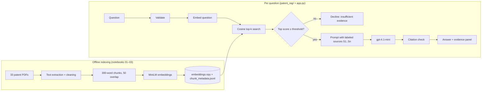

# AI Patent Research Assistant

A retrieval-augmented generation (RAG) application for asking natural-language questions about a collection of **33 AI-related US patents and patent applications**. The app finds the most relevant patent passages with semantic search, then has a language model write an answer **only from those passages**, with inline citations (`[S1]`, `[S2]`) that link back to the evidence.

> **Problem:** patent documents are long, dense and written in inconsistent terminology ("numeric representations of words" instead of "word embeddings"), so keyword search and manual reading are slow.
> **Approach:** semantic retrieval finds passages by meaning, and a grounded LLM summarizes only what those passages say. The interface always shows the evidence so a researcher can verify it.
> **Scope:** a research aid for exploration. It is not legal advice and not a prior-art, patentability or infringement tool.

## Features

- **Ask in plain English** and get an answer with inline source citations, or an explicit "insufficient evidence" response.
- **Evidence panel**: every retrieved passage shown with patent number, title, applicant, chunk ID, similarity score, rank, whether it was cited, and a Google Patents link.
- **Retrieval transparency**: retrieval/generation latency, number of passages retrieved vs. sent to the model, and the **exact prompt** sent to the LLM.
- **Semantic vs. keyword toggle**: compare embedding search with a TF-IDF baseline on the same question.
- **Relevance gate**: if no passage is similar enough, the LLM is not called and the app declines instead of guessing.
- **Graceful degradation**: no API key, outages, rate limits or malformed responses fall back to retrieval-only mode (or a clearly labeled *recorded* answer), never a stack trace.
- **Patent filter**: restrict search to selected patents.

## Technology stack (as implemented)

| Layer | Choice |
|---|---|
| Ingestion | `pdfminer.six` with `pypdf` fallback; manual OCR text for PDFs with no extractable text (notebook 01) |
| Chunking | 300-word windows, 50-word overlap → 2,905 chunks (notebook 02, `patent_rag/ingest.py`) |
| Embeddings | `sentence-transformers/all-MiniLM-L6-v2`, 384-dim, L2-normalized (notebook 03) |
| Vector index | NumPy matrix (`embeddings/embeddings.npy`) + JSONL metadata; exact cosine search (identical results to the notebooks' scikit-learn `NearestNeighbors`) |
| Keyword baseline | scikit-learn `TfidfVectorizer` |
| Generation | OpenAI Chat Completions, `gpt-4.1-mini`, temperature 0.2 |
| Interface | Streamlit |
| Tests | pytest (64 tests; no network or model download needed) |

## Architecture



```
app.py                     Streamlit UI
patent_rag/
  config.py                settings from environment / .env
  index.py                 load + validate embeddings and chunk metadata
  embedder.py              SentenceTransformer query embedding
  retrieval.py             semantic (cosine) and keyword (TF-IDF) retrievers
  prompts.py               system prompt, labeled source context, injection hygiene
  llm.py                   OpenAI call with error mapping
  citations.py             [S#] citation extraction/validation
  pipeline.py              orchestration, relevance gate, fallbacks
  recorded.py              labeled recorded answers for demo backup
  metadata.py              patent titles/applicants/links
  ingest.py                extraction, cleaning, chunking (from notebooks 01–02)
  validation.py            input validation
scripts/check_setup.py     pre-demo checklist
scripts/evaluate.py        retrieval evaluation (Hit@k, MRR, latency)
scripts/build_index.py     rebuild/verify the index
notebooks/                 original exploratory pipeline + manual evaluation
```

## Setup

Requires Python 3.10+ (developed on 3.12).

```bash
python -m venv .venv
# Windows PowerShell: .venv\Scripts\Activate.ps1     macOS/Linux: source .venv/bin/activate
pip install -r requirements.txt
```

Configure the API key (optional; without it the app runs in retrieval-only mode):

```bash
cp .env.example .env          # Windows: copy .env.example .env
# then edit .env and set OPENAI_API_KEY=...
```

`.env` is git-ignored. Environment variables set in your shell take precedence. The key is never logged or displayed.

## Run

```bash
python scripts/check_setup.py --ping   # verifies packages, index, model, key, demo queries
streamlit run app.py                   # opens http://localhost:8501
```

Run both from the project root. The first run downloads the embedding model (~90 MB) and caches it.

### Example questions

1. *How can a large language model be used to train or improve a smaller language model?*
2. *How do the patents use large language models to generate training data for dialogue systems?*
3. *How does the attention-free transformer reduce computational cost compared with standard attention?*
4. *What does this collection say about CRISPR gene editing in crops?* (out of scope: should decline)

## Testing and evaluation

```bash
python -m pytest -q                                  # unit tests
python scripts/build_index.py --check                # chunking reproduces the committed index exactly
python scripts/evaluate.py                           # semantic vs keyword retrieval metrics
python scripts/evaluate.py --methods keyword         # baseline only (no model needed)
```

See [EVALUATION.md](EVALUATION.md) for methodology and measured results, and [MODEL_CARD.md](MODEL_CARD.md) for the original manual evaluation of answer quality.

## Known limitations

- **Small, curated corpus** (33 documents) that includes several off-topic patents (battery fluid, image processing). Results do not generalize to a full patent database.
- **Noisy text**: OCR artifacts, figure labels and front-page boilerplate are embedded along with the content; some patents were manually pasted.
- **Chunk length vs. model limit**: `all-MiniLM-L6-v2` reads at most 256 word-piece tokens, so the end of many 300-word chunks is likely not represented in their embeddings (the full text is still sent to the LLM).
- **Hallucination is reduced, not eliminated.** The prompt, relevance gate and citation check make unsupported answers less likely and easier to spot; they do not prove each sentence is supported.
- **Relevance threshold** (`MIN_SIMILARITY=0.30`) is a starting point and should be calibrated with `scripts/evaluate.py`.
- **Small evaluation set** (39 author-written retrieval queries + 8 manually scored answers).
- **Single-user local demo**: no authentication, no persistence beyond a local cache, in-memory index.
- Google Patents links are constructed from patent numbers and are not stored in the source data.

## Data and license

Patent PDFs were downloaded from Google Patents for a course project (DNSC 3288). MIT license for the code. Portions of the original notebooks and of the v1.1 application code were developed with AI assistance (see MODEL_CARD.md).
